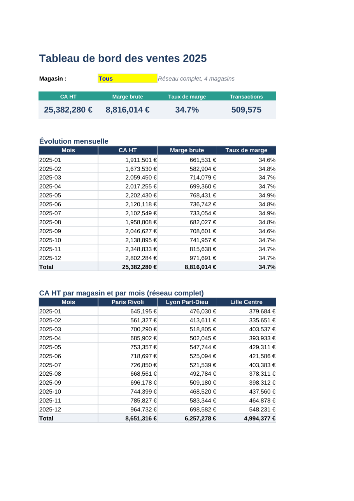
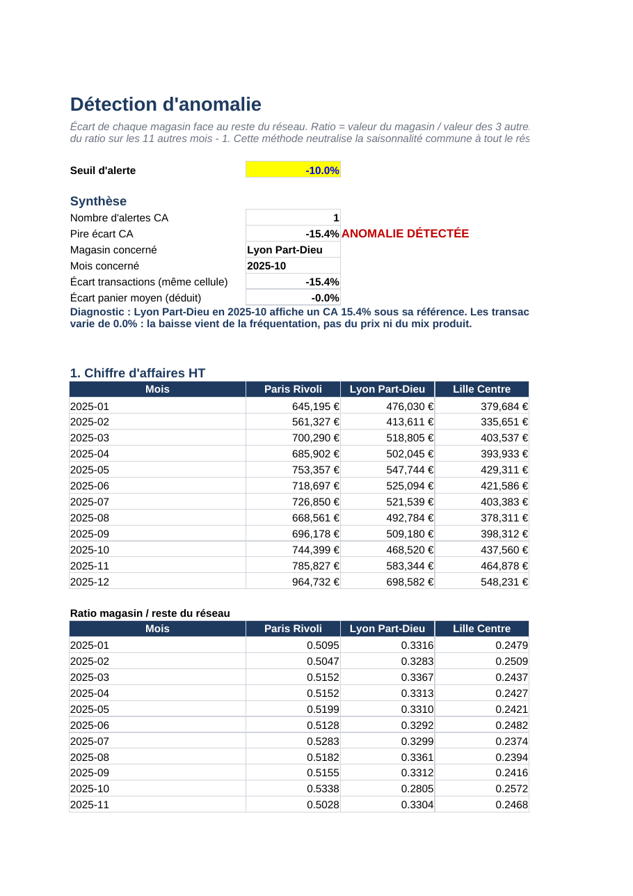

# Analyse de ventes retail : suivi de KPI et détection d'anomalie sous Excel

Projet d'analyse de données réalisé sous Excel sur un an de ventes d'un réseau de magasins. J'ai construit un tableau de bord de suivi d'indicateurs, puis j'ai utilisé des tableaux croisés dynamiques pour comparer les magasins mois par mois. Cette analyse m'a permis de repérer une anomalie : en octobre 2025, le magasin de Lyon Part-Dieu réalise environ **15 % de chiffre d'affaires en moins** que sa référence habituelle, et la baisse s'explique entièrement par la fréquentation.

> Les données sont **fictives** et générées par script. Elles servent uniquement de support à la démarche d'analyse.



## Contexte

Le jeu de données représente un réseau de 4 magasins (Paris Rivoli, Lyon Part-Dieu, Lille Centre, Bordeaux Lac) qui vendent 5 catégories de produits (Alimentaire, Maison, Textile, Électronique, Beauté). Chaque ligne correspond aux ventes d'une catégorie, dans un magasin, sur une journée de 2025, soit 7 300 lignes au total.

| Colonne | Description |
|---|---|
| Date, Mois | Jour de vente et mois au format AAAA-MM |
| Magasin, Région | Point de vente et région |
| Catégorie | Famille de produits |
| Nb_transactions | Nombre de tickets de caisse |
| Quantité | Nombre d'articles vendus |
| CA_HT | Chiffre d'affaires hors taxes (€) |
| Coût_achat | Coût d'achat des produits vendus (€) |
| Marge | Calculée dans Excel : CA_HT moins Coût_achat |

## Contenu du classeur

Le fichier `excel/analyse_ventes_retail_2025.xlsx` contient cinq onglets.

**Lisez-moi** présente le projet, la méthode et la légende des couleurs.

**Données** contient la table brute, filtrable, avec la marge calculée par formule.

**Tableau de bord** regroupe les KPI (CA HT, marge brute, taux de marge, transactions, panier moyen, articles par ticket), l'évolution mensuelle avec la variation d'un mois sur l'autre, la répartition du CA par magasin et deux graphiques. Une liste déroulante permet de filtrer tout le tableau de bord sur un magasin.

**TCD** contient trois tableaux croisés dynamiques construits sur la table de données : somme du CA par mois et par magasin, somme des transactions, et part de chaque magasin dans le CA du mois (affichage en % du total de la ligne). C'est ce dernier TCD qui fait ressortir le décrochage de Lyon en octobre.

**Détection anomalie** quantifie l'écart, applique un seuil d'alerte paramétrable et rédige automatiquement le diagnostic.

Tous les indicateurs sont calculés par formules (SOMME.SI.ENS, INDEX/EQUIV, NB.SI...) : si les données changent, le classeur se met à jour.

## Méthode de détection

Comparer simplement un mois au précédent ne suffit pas, car tout le réseau suit la même saisonnalité (creux en février et en août, pic en décembre). Pour isoler un problème propre à un magasin, j'ai procédé en trois étapes.

1. Pour chaque magasin et chaque mois, calcul du ratio entre le CA du magasin et le CA des trois autres magasins. Ce ratio est stable dans le temps quand tout va bien, puisque la saisonnalité touche tout le monde.
2. Comparaison du ratio de chaque mois à la moyenne du même ratio sur les 11 autres mois. L'écart obtenu mesure la sur ou sous-performance du magasin par rapport à son niveau habituel.
3. Déclenchement d'une alerte quand l'écart passe sous le seuil de -10 %. Sur l'année, le bruit normal reste sous 4 % en valeur absolue, ce qui laisse une marge confortable.

La même méthode appliquée au nombre de transactions permet ensuite de séparer l'effet fréquentation de l'effet panier moyen.



## Résultats

| Indicateur | Valeur |
|---|---|
| CA HT annuel du réseau | 25,4 M€ |
| Taux de marge brute | 34,7 % |
| Transactions | 509 575 |
| Panier moyen | 49,81 € |
| Alertes détectées | 1 |
| Magasin et mois concernés | Lyon Part-Dieu, octobre 2025 |
| Écart de CA vs référence | -15,4 % |
| Écart de transactions | -15,4 % |
| Écart de panier moyen | 0,0 % |

**Lecture :** en octobre, Lyon perd environ 15 % de chiffre d'affaires par rapport à son poids habituel dans le réseau. Le nombre de transactions baisse dans les mêmes proportions alors que le panier moyen ne bouge pas. Le problème ne vient donc ni des prix ni du mix produit, mais du nombre de clients passés en caisse. Les pistes à vérifier sur le terrain seraient une panne d'encaissement, des travaux d'accès, une fermeture partielle ou un problème de remontée des données.

Dans le jeu de données, cette anomalie a été volontairement injectée (baisse de fréquentation de 15 % sur Lyon en octobre) afin de valider que la méthode la retrouve bien.

## Arborescence

```
retail-sales-kpi-analysis/
├── data/
│   └── ventes_retail_2025.csv        données brutes (séparateur ;)
├── excel/
│   └── analyse_ventes_retail_2025.xlsx
├── scripts/
│   ├── generate_data.py              génération des données fictives
│   ├── build_workbook.py             construction du classeur (formules, graphiques)
│   └── add_pivot_tables.py           ajout des tableaux croisés dynamiques
├── docs/
│   ├── methodologie.md
│   └── images/
├── requirements.txt
└── LICENSE
```

## Reproduire le projet

Il suffit d'ouvrir le fichier Excel. Pour régénérer l'ensemble à partir de zéro :

```bash
pip install -r requirements.txt
python scripts/generate_data.py
python scripts/build_workbook.py
python scripts/add_pivot_tables.py   # nécessite LibreOffice
```

## Compétences mobilisées

Excel (tableaux croisés dynamiques, SOMME.SI.ENS, INDEX/EQUIV, mise en forme conditionnelle, validation de données, graphiques), définition et suivi de KPI retail, détection d'anomalie par comparaison à un groupe de référence, diagnostic d'un écart (fréquentation contre panier moyen), Python (pandas, openpyxl) pour la préparation des données.

## Auteure

Khadija Ferouat, étudiante en cycle ingénieur à l'ECE Paris (filière Data, Cyber, IA).
